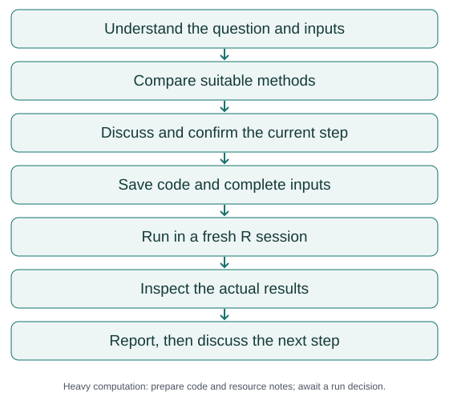

# EpiStepLab

**English** | [简体中文](docs/zh-CN/README.md)

Discuss, run, and check R analyses of medical public databases—one research step at a time.

**[Download v1.1.0](https://github.com/hujizhou35-cmd/EpiStepLab/releases/tag/v1.1.0) · [Quick start](docs/guides/quickstart.md) · [Prepare your research](docs/guides/research-preparation.md)**

Source version on this page: v1.1.0. [v1.1.0](https://github.com/hujizhou35-cmd/EpiStepLab/releases/tag/v1.1.0) is the current recommended download.

## Who it is for

For researchers who want to understand and decide how their analysis proceeds. Bring a research question, data or its availability status, variable dictionaries and indicator definitions, and a directory where files may be saved. For each confirmed step, you get readable R code, complete inputs, actual outputs, and check notes.

When working manually with medical public databases, the author kept each step in its own folder with R code, inputs, and outputs. That made the work easier to inspect, change, and repair. EpiStepLab asks AI to continue that habit.

## How it works



The question determines the steps and methods. Each step carries its complete inputs and runs in a fresh R session.

**SIMULATED EXAMPLE — illustrative directory only:**

```text
03_current_simulated_step/
  run.R
  input_simulated.csv
  output_simulated.csv
  checks.md
  step-notes.md
```

[See the simulated example](docs/examples/README.md). It represents no real research result or authorization to analyze real data.

## Start in three steps

1. [Get the complete skill and choose an installation route](docs/guides/installation.md). Load only one version at a time.
2. Provide your question, data and dictionaries, indicator information, and allowed output directory.
3. Discuss and confirm the current step, then save code, run it, and inspect the actual results.

```text
Use EpiStepLab. My topic is [topic], my data and dictionaries are in [path],
and you may write to [directory]. First check the data, indicator definitions,
and relevant methods. Explain the decisions I need to make.
Implement only the current confirmed step, with complete inputs, readable
R code, actual outputs, and check notes.
```

[Start a study](docs/guides/quickstart.md) · [Resume existing work](docs/guides/resuming.md)

## Before you begin

Consider discussing your topic with another AI first: what are the exposure and outcome, which components and variables define them, how are they calculated, and what question and methods might fit? You do not need to prove that conversation happened. Its answers still need checking. [Preparation guide and prompt](docs/guides/research-preparation.md)

v1.1.0 traces original definitions and application studies, recording available PMID/DOI identifiers, formulas, units, field mappings, and source locations. Unclear or conflicting definitions are discussed before code is written.

## Capabilities and limits

- Discuss and confirm each step; write ordinary R code; run and inspect saved tables and figures. Flag downstream work when inputs change.
- Choose methods for the question and data. Compare simple and newer approaches, including reasons to avoid unnecessary complexity.
- MR is outside the skill. Prepare code and resource notes for BKMR or other heavy computation, then await a specific run decision.
- Researchers remain responsible for their decisions. The skill does not promise an automatically publishable paper.

The runtime skill, references, templates, and code comments are currently **in Chinese**. Bilingual documentation does not establish validated English-language behavior.

The host needs local file access; execution needs R; literature discovery needs internet tools; visual review needs an image viewer. These capabilities and full-text access are not bundled. Existing technical records used Windows 11 and R 4.4.2. Other hosts, operating systems, automatic triggering, and RStudio GUI operation have not been comprehensively tested. [Environment and installation](docs/guides/installation.md)

## Versions

| Version | Main content | Use |
|---|---|---|
| [v1.1.0](https://github.com/hujizhou35-cmd/EpiStepLab/releases/tag/v1.1.0) | Adds indicator provenance, method discovery at startup/resumption, and open method comparison | Recommended download |
| [v1.0.0](https://github.com/hujizhou35-cmd/EpiStepLab/releases/tag/v1.0.0) | Step confirmation, complete inputs, fresh R sessions, and result checking | Historical version |

Both are formal releases. A newer version does not establish better scientific validity or superiority in every capability.

## Validation and contributions

v1.0.0 records 17 simulated technical scenarios and 9 AI behavior scenario types, with a targeted retest after a missed reminder. v1.1.0 records 11 process scenarios (4 successful methods and 7 refusals), 26 numeric checks, and 6 behavior scenarios. These are technical and behavioral records, not independent medical studies or validation on real databases.

[Validation reports](docs/validation/README.md) · [Contributing](.github/CONTRIBUTING.md) · [Report an issue](https://github.com/hujizhou35-cmd/EpiStepLab/issues)

By [Jizhou Hu](https://github.com/hujizhou35-cmd). Original project content is available under [MIT](LICENSE). See [CITATION.cff](CITATION.cff) for citation metadata.
