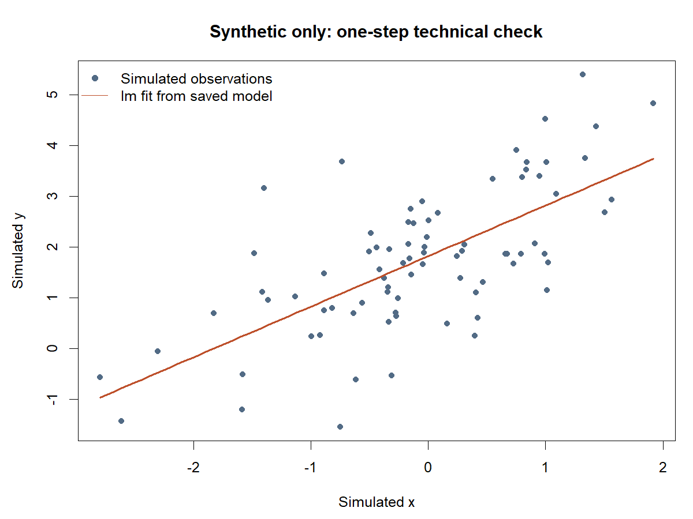

# 模拟单步示例

[English](README.md) | **简体中文** · [首页](../zh-CN/README.md)

**全部数据为模拟数据，非 NHANES 或其他真实数据库。** 此例展示已记录的技术测试当前一步，不是实际研究或通用推荐方法。

80 条模拟记录来自固定技术夹具。普通 lm 仅用于检查输入、模型表与绘图数据交接；参数不是研究默认值。

- [完整模拟输入](simulated-lm/输入_模拟数据.csv)
- [实际系数表](simulated-lm/输出_系数表.csv)
- [底层绘图数据](simulated-lm/输出_绘图数据.csv)
- [独立模拟技术测试源码](../../development/tests/README.zh-CN.md)

此处仅展示输入、输出及图；复跑使用开发测试夹具，不依赖作者私有数据。生成和检验方法见源码。检查通过不证明医学有效性，也不授权真实研究。
