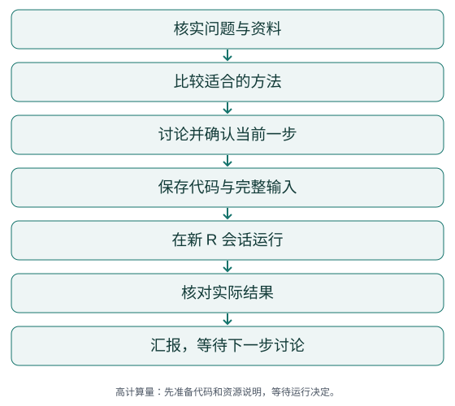

# EpiStepLab

[English](../../README.md) | **简体中文**

与 AI 逐步讨论、运行和检查医学公共数据库的 R 分析。

**[下载 v1.1.0](https://github.com/hujizhou35-cmd/EpiStepLab/releases/tag/v1.1.0) · [快速开始](quickstart.md) · [研究准备](research-preparation.md)**

本页源码版本：v1.1.0。 当前推荐下载为 [v1.1.0](https://github.com/hujizhou35-cmd/EpiStepLab/releases/tag/v1.1.0)。

## 适合谁，需要什么，得到什么

适合愿意理解并决定自己研究的使用者。带来研究主题、数据或获取状态、字段字典与指标资料，以及允许保存文件的目录。EpiStepLab 会与您讨论选择，再完成当前确认的一步，保存普通可读的 R 代码、完整输入、实际结果和检查记录。

作者过去人工分析医学公共数据库时，会按步骤分文件夹，保存 R 代码、所需输入和实际输出，便于查看、修改和修复。EpiStepLab 希望让 AI 延续这种研究习惯。

## 怎样推进



步骤由研究问题安排，不固定数量或方法套餐。每步目录带齐自己的输入，可在新 R 会话独立运行。

**模拟目录示例，全部内容仅用于展示：**

```text
03_当前模拟步骤/
  运行.R
  输入_模拟数据.csv
  输出_模拟结果.csv
  检查记录.md
  本步说明.md
```

[查看完整模拟示例说明](../examples/README.zh-CN.md)。它不是真实研究结果，也不授权开展实际分析。

## 三步开始

1. [取得完整技能并选择使用入口](installation.md)。两版同名，一次只加载一版。
2. 提供研究主题、数据与字典、指标资料和允许写入的目录。
3. 先讨论与确认当前一步，再保存代码、运行和核对实际结果。

```text
请使用 EpiStepLab。我的研究主题是〔主题〕，数据和字典位于〔路径〕，
允许写入〔目录〕。先核实数据、指标定义和相关方法，解释需要我决定的问题。
每次只实现当前确认的一步，保存完整输入、普通可读的 R 代码、
实际结果和检查记录。
```

[开始新研究](quickstart.md) · [中断后接续](resuming.md)

## 使用前先理解研究

建议先与其他 AI 深入讨论：暴露和结局是什么，指标有哪些分量、怎样计算、需要什么变量，希望回答什么问题，以及哪些方法可能适合。无需提交外部对话证明；其他 AI 的回答仍需核实。[研究准备与提示词](research-preparation.md)

v1.1.0 会追溯原始定义和应用研究，记录 PMID、DOI 或其他真实标识、公式、单位、字段映射和原文位置。定义冲突或资料不清时先讨论，再写代码。

## 能力和必要限制

- 每一步先讨论确认，再写普通 R 代码，运行并查看实际表图；上游变化会提示下游需重查。
- 方法随问题和数据选择，可以比较简单方法与新方法，也可以建议不采用复杂方法。
- MR 不纳入；BKMR 等高计算量步骤先准备代码和资源说明，等待具体运行决定。
- 使用者仍需理解并决定研究，技能不承诺自动完成可发表论文。

技能主体、参考文件、模板和代码注释目前为中文。双语文档不代表英文行为已经验证。

宿主需能读取本地文件；执行阶段需要 R，检索需要联网和相应工具，视觉核对需要实际图像查看能力。技能包不自带这些环境或全文权限。现有技术记录来自 Windows 11、R 4.4.2；跨平台、自动触发和 RStudio GUI 尚未全面验证。[安装与环境说明](installation.md)

## 版本

| 版本 | 主要内容 | 下载定位 |
|---|---|---|
| [v1.1.0](https://github.com/hujizhou35-cmd/EpiStepLab/releases/tag/v1.1.0) | 新增指标溯源、启动/接续方法检索、开放的方法比较 | 当前推荐 |
| [v1.0.0](https://github.com/hujizhou35-cmd/EpiStepLab/releases/tag/v1.0.0) | 逐步确认、完整输入、独立 R 会话与结果复核 | 历史版本 |

两版均为正式发布。版本较新不表示科学有效性或所有能力全面优于旧版。

## 验证与参与

v1.0.0 记录了 17 个模拟技术场景、9 类 AI 行为演练及一次针对遗漏提醒的复测。v1.1.0 记录了 11 个进程场景（4 个方法成功、7 个拒绝）、26 项数值检查和 6 类行为演练。这些是技术与行为证据，不是独立医学研究或真实数据库有效性验证。

[完整验证说明](../validation/README.zh-CN.md) · [贡献指南](../../.github/CONTRIBUTING.zh-CN.md) · [报告问题](https://github.com/hujizhou35-cmd/EpiStepLab/issues)

作者：[Jizhou Hu](https://github.com/hujizhou35-cmd)。自有内容采用 [MIT](../../LICENSE)。引用信息见 [CITATION.cff](../../CITATION.cff)。
